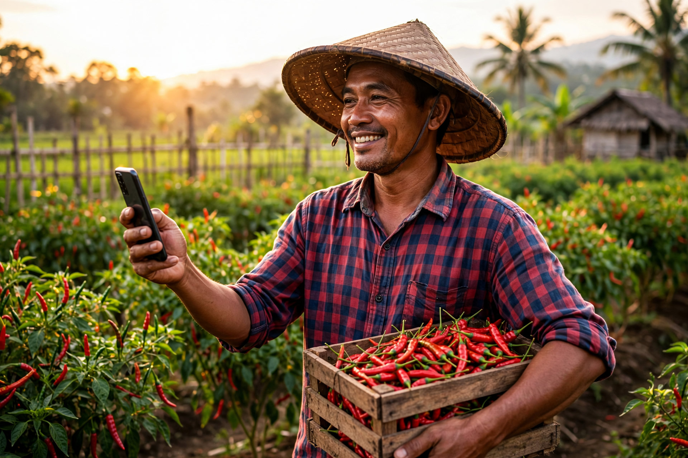
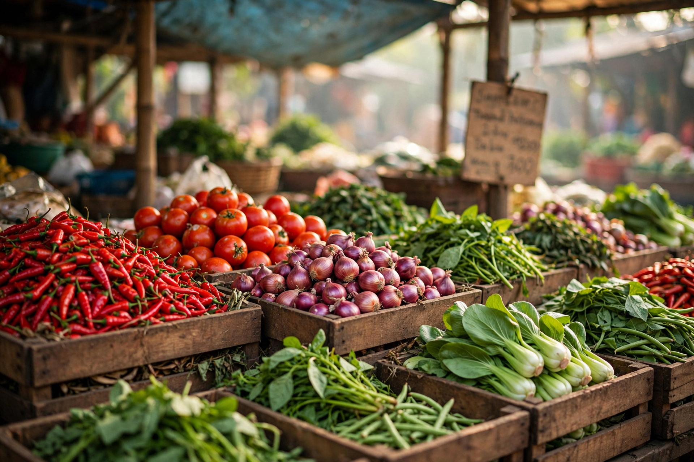
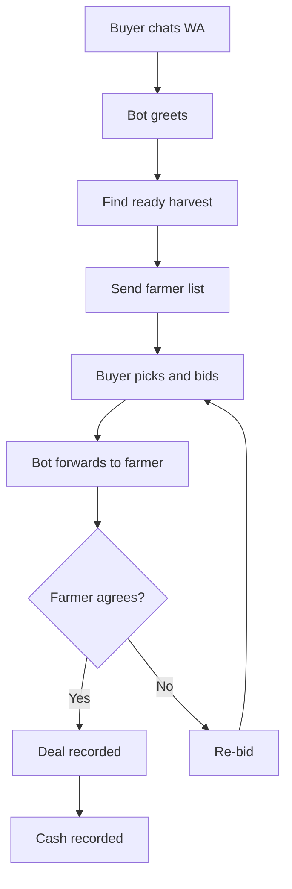

# Hai Tani (TaniAI)

> Dari Petani, untuk Kesejahteraan Petani ("From Farmers, for Farmers' Welfare")


*Illustration: a farmer using Hai Tani by phone in the field (Hai Tani illustration).*

## Overview

Hai Tani (TaniAI) is a WhatsApp-first marketplace assistant that connects Indonesian smallholder farmers directly with buyers. It addresses low farm-gate prices caused by long distribution chains and weak market information. Farmers chat in Indonesian or by voice note to register harvests, check market prices, and negotiate with verified buyers. The platform includes an admin dashboard, price anomaly alerts, a spatial farmer-supplier map, spreadsheet sync, and registration cards with QR codes. It is built on the WhatsApp Cloud API via Meta for Developers with an Express + React stack.

## Problem Background

Indonesian farmers carry long distribution chains and weak bargaining power:

- Farmer scale: 29.34 million farm businesses (2023) vs 31.70 million (2013); ~40% of farmers are over 55; millennial farmers (19-39) only 21%. Source: 2023 Agricultural Census via Jurnal Sukowati (BPS author) — https://journal.sragenkab.go.id/index.php/sukowati/article/view/493
- Middleman dependence: 68% of farmers rely on middlemen as the main channel, 32% sell direct; main constraints are limited market-information access, minimal capital, poor infrastructure — https://journal.yrpipku.com/index.php/msej/article/view/7858
- Thin income: Farmer Exchange Rate down from 110.12 (2023) to an average 106.85 (2024); rice farmers' net income only Rp1.8 million/hectare/season; harvest-season grain price ±Rp5,000/kg, lower via middlemen — https://jurnal.bapperida.grobogan.go.id/jbp/article/download/101/45
- Long chain: Farmer → Middleman → Miller → Aggregator → Retailer → Consumer; the grain-vs-rice price gap harms farmers (sample: 70 farmers, 8 middlemen, 4 millers, 7 wholesalers, 5 retailers) — https://jurnal.uinsu.ac.id/index.php/tawassuth/article/view/14855
- Supporting findings (snippet level, real URLs): 81.43% of rice farmers sell to middlemen — https://jurnal.erapublikasi.id/index.php/JPPM/article/download/897/609 ; grain price fell Rp8,300 → Rp6,800/kg — https://jurnal.almaidah.or.id/index.php/AMANAH/id/article/download/324/286/1033 ; grain price often drops below the floor price at peak harvest — https://ejurnal.dpr.go.id/index.php/jurnalbudget/article/download/134/123

WhatsApp is the right channel:

- Indonesian internet users 2024: 221,563,479 of a 278,696,200 population (79.5% penetration, up 1.4%); rural share 30.5% vs urban 69.5%; survey of 8,720 respondents in 38 provinces — https://apjii.or.id/berita/d/apjii-jumlah-pengguna-internet-indonesia-tembus-221-juta-orang
- WhatsApp is Indonesia's #1 platform, used by ~90-90.8% of internet users monthly — https://www.ungkit.com/2026/10/the-most-widely-used-social-media.html ; Indonesia has 94.3 million users — a global top-3 country — https://searchengineland.com/guide/whatsapp-users
- Indonesian social media audience 180 million (+26% YoY), 62.9% of population; WhatsApp leads monthly usage — https://www.marketing-interactive.com/report-indonesia-s-social-media-audience-hits-180-million-driving-brand-discovery
- Farmers already sell via WA (case studies): daily harvest promotion via WA — https://ejournal.baleliterasi.org/index.php/kasta/article/download/3130/1554 ; direct selling via WA (guava Rp10,000/kg), margin up — https://jurnal.umpwr.ac.id/index.php/jrap/article/download/6606/2780/19772


*Illustration: Hai Tani's reference prices come from traditional markets (Hai Tani illustration).*

## Pivot Story

Hai Tani started as a general AI assistant for farmers: photo-based disease analysis, medicine and fertilizer Q&A from verified research, market prices, plus a farm-data monitoring dashboard. After talking with many farmers, the most basic complaint turned out to be one thing: access to buyers. Farmers relied on the same middlemen, harvests were bought cheap, middlemen controlled market selling, farmers kept razor-thin margins.

The focus pivoted to buyer matchmaking: connecting buyers looking for goods with ready-to-harvest (or soon-to-harvest) farmers through documented WhatsApp negotiation, backed by market prices, a verified directory, and a distribution map.

## Negotiation Flow



Details: [docs/negotiation-flow.md](docs/negotiation-flow.md).

## Features (only repo-proven ones)

- Express + TypeScript backend + React + Vite frontend (dev/build/start scripts; server.ts, package.json, App.tsx).
- Session auth + RBAC (login/logout, same-origin session cookie; App.tsx, main.tsx).
- 6-tab admin dashboard: Overview, Chat Simulator, Data, Price & Anomalies, Data Scientist, Map (App.tsx).
- WA chatbot simulator + voice-note player for low-text-literacy farmers (WhatsAppChatbot.tsx).
- WhatsApp webhook + stateless anti-loop forwarder supporting text/button/location/voice-image-document media (server.ts, api/webhook/whatsapp.ts).
- Multi-provider AI dispatcher + rule-based fallback when all providers are down (server.ts).
- Multimodal AI service for voice transcription and image/document vision (server.ts).
- Write-behind spreadsheet sync: Farmer/Supplier/Cash/Stock tabs + commodities/feedback, status and sync-now endpoints, plus CSV/XLSX export (lib/sheets-sync.ts, server.ts).
- Online spreadsheet connector: list, create new spreadsheet, read metadata (workspace service module).
- Spatial farmer/supplier map + Haversine distance (FarmerSupplierMapView.tsx).
- Farmer/supplier CRUD + add modals + sync-status toasts (App.tsx).
- Market prices + anomaly detection/EWS + notification broadcast + fruit price management (MarketAnomalyView.tsx, MarketPriceTable, FruitPriceManager).
- Data scientist portal + agronomy fertilizer recommendation calculator (DataScientistPortal, lib agronomy).
- Laya stdlib intent sidecar (8 intents: daftar_lahan through lain) + status endpoint (laya_sidecar.py, App.tsx).
- Registration Card PDF + QR + architecture whitepaper PDF (qrcode, generateArchitecturePdf).
- Media upload + append-only training event log (multer, data/training/*.jsonl).
- Public landing + verified farmer directory + public map + wa.me CTA (PublicView.tsx).
- Indonesian privacy page (public/privacy.html).

## WhatsApp Cloud API + Meta for Developers

The Meta angle (honest: what is live vs roadmap):

Already in code (official Meta patterns):

- Webhook GET verification: reads hub.mode/hub.verify_token/hub.challenge, matches the token, replies 200 + challenge when mode=subscribe, else 403 (server.ts). Official reference: https://developers.facebook.com/documentation/business-messaging/whatsapp/webhooks/create-webhook-endpoint
- Webhook POST: parses entry.changes[0].value.messages[0] (text/button/location) + entry.statuses to log; verifies the X-Hub-Signature-256 header (HMAC-SHA256 over rawBody against the app secret); optional FORWARD_SECRET gate; replies 200 EVENT_RECEIVED (server.ts).
- Outbound Cloud API: POST graph.facebook.com/v24.0/{phoneId}/messages with a Bearer token (sendWaText and sendWaTemplate: template name + language code + body parameters); starter template info_terbaru_taniai; the code notes the customer-service window concept (server.ts). Template reference: https://developers.facebook.com/documentation/business-messaging/whatsapp/templates/overview ; production tokens: https://developers.facebook.com/documentation/business-messaging/whatsapp/access-tokens ; permissions: https://developers.facebook.com/documentation/business-messaging/whatsapp/permissions

Not yet / roadmap:

- Cloud API Media API not used (no /media or media_id usage in the repo).
- Production live status unverified (.env holds secrets and was not opened in audit; not checked in the App Dashboard).
- Per-conversation pricing, business verification duration, and webhook response-time limits not researched from primary sources — do not quote as fact.

## Stakeholder Benefits

- Farmers: market price reference for bargaining power; direct negotiation with buyers via chat + voice note; crop clinic + nearest farm-shop info; QR registration card for program identity. Risk: farmers limited to basic WA with poor signal/devices still struggle with the map/dashboard — https://journal.unhas.ac.id/index.php/jsep/article/download/46768/13436
- Middlemen/collectors: supply certainty via distribution map + verified directory; documented negotiation; price signals and anomaly alarms; tidy partner records. Risk: price transparency erodes margins that live on information asymmetry — https://jurnal.unived.ac.id/index.php/agritepa/article/download/8664/6968/ ; some collectors may resist adoption.
- Buyers/offtakers: verified sourcing (location, commodity, contact); direct negotiation; buy planning from live prices + trends + anomaly alarms; supply aggregation analytics. Risk: crowd-input data can go stale without update SLAs and field verification.
- Government/agency/extension (PPL): price monitoring + anomaly broadcast complementing SP2KP (~514 districts/cities) — https://jawawa.id/newsitem/wamendag-government-to-clamp-down-on-minyakita-sales-above-the-price-ceiling-1772776818 ; chatbot as PPL extension (officer-to-farmer ratio ~1:1,500 — https://journal.lenvari.org/issr/article/download/345/188/2233); farmer census + QR cards; field operations. Risk: a chatbot does not replace field visits — https://journal.papsel.org/index.php/JPD/article/download/340/309
- Farm shops (kios saprodi): discovered by farmers via nearest-shop search + map pins; easy registration; demand prediction from planting/harvest schedules; QR card supports targeted subsidy redemption (iPubers context — https://journal.unpas.ac.id/index.php/pendas/article/download/41894/22640). Risk: rogue shops above the price ceiling are threatened by transparency.

Note: actual adoption (registered farmers/buyers, negotiation volume) has no data yet; benefits above are feature-based potential, not measured results.

## Market: TOM/SAM/SOM (summary)

- 2023 agritech spend TOM: USD 885.7M ≈ Rp14.0T (cross-check USD 500M ≈ Rp7.9T) → Rp7.9-14.0T range; 2033 projection ≈ Rp48.0T; AI-in-agriculture sub-segment 2025 ≈ Rp2.2T. Sources: https://www.kdmarketinsights.com/reports/indonesia-agritech-market/7611 , https://startuprise.org/agritech-startups-of-indonesia-2024/ , https://mobilityforesights.com/product/indonesia-artificial-intelligence-in-agriculture-market
- WA-reachable farmer SAM (upper bound): 29.34M farm businesses × 79.5% × 90% ≈ 21.0M farmers × Rp100-300K/year ARPU ≈ Rp2.1-6.3T/year. Basis: Agricultural Census, APJII, WA data above. ARPU = author assumption, needs field validation.
- 3-5 year SOM (Java-Sumatra, horticulture): assumed 1-3% share of SAM → Rp21-189M/year (subscription). Benchmark: Sayurbox ~1M customers, >10,000 partner farmers, $120M Series C — https://startuprise.org/agritech-startups-of-indonesia-2024/
- Full figures + assumptions: [docs/market-TOM-SAM-SOM.md](docs/market-TOM-SAM-SOM.md).

## Carbon Roadmap

Hai Tani's farm activity logs are built to become carbon value. Verified landscape: IDXCarbon (~1.98M tCO2e / Rp93.81B through June 2026), mandatory SRN PPI registry, and Agriculture Regulation 18/2026 opening rice/livestock/plantation credits with mandatory farmer benefit-sharing. Hai Tani positions as the MRV data pipeline feeding aggregators (e.g. Fairatmos) and standards (Verra / Gold Standard / Plan Vivo) — profit shared with farmers.

Farmers: log every unburned residue, every kilogram of fertilizer saved, every tree planted. Full intent, architecture, and data-gap plan: [docs/carbon-roadmap.md](docs/carbon-roadmap.md).

## Founder

Founder statement:

EN: Hello Farmers, I am Mochammad Setiawan Putra, an ornamental plant farmer with 6 years of experience. I run SnS Nursery in Batu, East Java, Indonesia, serving plant requests by DM and shipping worldwide.

Independently verified:

- Account https://www.instagram.com/sns.nursery = "SnS Nursery", Batu – East Java; bio: worldwide shipping, requests via DM (2,236 followers at fetch time).
- 19/12/2021 invoice — https://www.scribd.com/document/827076449/Invoice-Tal-011221 proves SNS Nursery Batu has sold ornamental plants since at least Dec 2021.
- Profile https://www.facebook.com/Blokir88 shows the name "Setiawan Putra" (rest of the profile needs login).
- LinkedIn https://www.linkedin.com/in/mochammad-setiawan-putra-07a6268a/ (slug exactly matches the full name; profile content cannot be auto-fetched due to LinkedIn anti-scrape blocking).

Not yet publicly verified: the link between the founder's name and the nursery account, and the 6-year duration claim (needs direct evidence such as a bio/screenshot naming both).

## Architecture (short)

React + Vite client (admin dashboard, chat simulator, map, public landing) → Express + TypeScript server (session auth, CRUD, price/anomaly, export) → WhatsApp webhook (subscribe verification, HMAC signature, forwarder) → multi-provider AI dispatcher + rule fallback → local data + write-behind spreadsheet sync → Laya intent sidecar → QR card and PDF output.

## Local Setup

Prerequisite: Node.js + npm.

```bash
npm install
npm run dev
```

Server: http://127.0.0.1:3000 (default `PORT` when the env is unset; see server.ts). Build/production: `npm run build` then `npm start`. Minimum env for the WA webhook: WHATSAPP_VERIFY_TOKEN, WHATSAPP_APP_SECRET, access token + phone number ID (see server.ts). AI service keys and spreadsheet sync are optional as needed.

## Test Evidence (Phase 3, in Indonesian)

- [Functional test recap 100/100](docs/fase3/01-rekap-uji-fungsional.md)
- [Stress test 104 rps, 0 failures](docs/fase3/02-uji-stres.md)
- [WCAG accessibility pre-audit](docs/fase3/03-aksesibilitas-wcag.md)

## License

TBD — decide before public release (e.g. proprietary / MIT / Apache-2.0).

## Tool Credit

Built with Muse Code (Meta).
