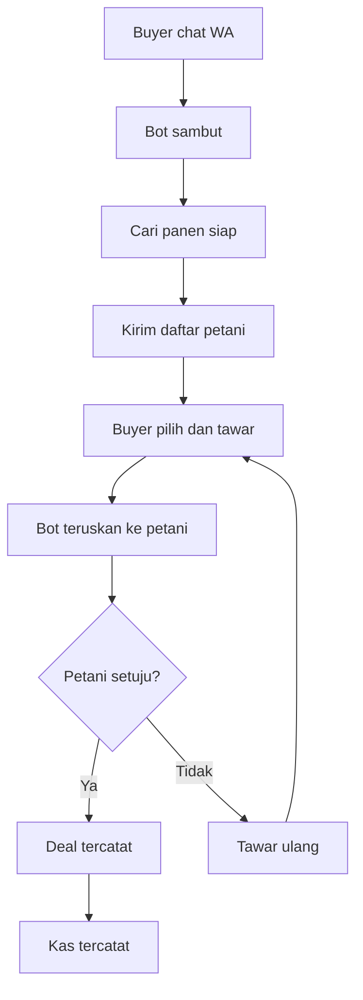

# Hai Tani (TaniAI)

> Dari Petani, untuk Kesejahteraan Petani


*Ilustrasi: petani memakai Hai Tani lewat ponsel di ladang (gambar ilustrasi Hai Tani).*

## Summary (English)

Hai Tani (TaniAI) is a WhatsApp-first marketplace assistant that connects Indonesian smallholder farmers directly with buyers. It addresses low farm-gate prices caused by long distribution chains and weak market information. Farmers chat in Indonesian or by voice note to register harvests, check market prices, and negotiate with verified buyers. The platform includes an admin dashboard, price anomaly alerts, a spatial farmer-supplier map, spreadsheet sync, and registration cards with QR codes. It is built on the WhatsApp Cloud API via Meta for Developers with an Express + React stack.

## Latar Masalah

Petani Indonesia menanggung rantai distribusi panjang dan posisi tawar lemah:

- Skala petani: 29,34 juta usaha pertanian (2023) vs 31,70 juta (2013); ~40% petani berusia >55 tahun; petani milenial (19-39 tahun) hanya 21%. Sumber: Sensus Pertanian 2023 via Jurnal Sukowati (penulis BPS) — https://journal.sragenkab.go.id/index.php/sukowati/article/view/493
- Ketergantungan tengkulak: 68% petani mengandalkan tengkulak sebagai saluran utama, 32% jual langsung; kendala utama keterbatasan akses informasi pasar, minim modal, kurang infrastruktur — https://journal.yrpipku.com/index.php/msej/article/view/7858
- Pendapatan tipis: Nilai Tukar Petani turun 110,12 (2023) ke rata-rata 106,85 (2024); pendapatan bersih petani padi hanya Rp1,8 juta/hektare/musim; harga gabah panen raya ±Rp5.000/kg, lebih rendah bila ke tengkulak — https://jurnal.bapperida.grobogan.go.id/jbp/article/download/101/45
- Rantai panjang: pola Petani → Tengkulak → Penggilingan → Pengepul → Pengecer → Konsumen; selisih harga gabah vs beras merugikan petani (sampel 70 petani, 8 tengkulak, 4 penggilingan, 7 grosir, 5 pengecer) — https://jurnal.uinsu.ac.id/index.php/tawassuth/article/view/14855
- Temuan pembanding (level cuplikan, URL nyata): 81,43% petani padi menjual ke tengkulak — https://jurnal.erapublikasi.id/index.php/JPPM/article/download/897/609 ; harga gabah jatuh Rp8.300 → Rp6.800/kg — https://jurnal.almaidah.or.id/index.php/AMANAH/id/article/download/324/286/1033 ; harga gabah sering anjlok di bawah HPP saat panen raya — https://ejurnal.dpr.go.id/index.php/jurnalbudget/article/download/134/123

WhatsApp adalah kanal yang tepat:

- Pengguna internet Indonesia 2024: 221.563.479 jiwa dari populasi 278.696.200 (penetrasi 79,5%, naik 1,4%); kontribusi rural 30,5% vs urban 69,5%; survei 8.720 responden 38 provinsi — https://apjii.or.id/berita/d/apjii-jumlah-pengguna-internet-indonesia-tembus-221-juta-orang
- WhatsApp platform #1 Indonesia, dipakai ~90-90,8% pengguna internet per bulan — https://www.ungkit.com/2026/10/the-most-widely-used-social-media.html ; Indonesia 94,3 juta pengguna — negara top-3 global — https://searchengineland.com/guide/whatsapp-users
- Audiens medsos Indonesia 180 juta (+26% YoY), 62,9% populasi; WhatsApp memimpin monthly usage — https://www.marketing-interactive.com/report-indonesia-s-social-media-audience-hits-180-million-driving-brand-discovery
- Petani sudah memakai WA untuk jualan (studi kasus): promosi panen harian via WA — https://ejournal.baleliterasi.org/index.php/kasta/article/download/3130/1554 ; jual langsung via WA (jambu Rp10.000/kg), margin naik — https://jurnal.umpwr.ac.id/index.php/jrap/article/download/6606/2780/19772


*Ilustrasi: harga pasar acuan Hai Tani berasal dari pasar tradisional (gambar ilustrasi Hai Tani).*

## Cerita Pivot

Hai Tani bermula sebagai asisten AI umum untuk petani: analisis penyakit via foto, tanya jawab obat dan pupuk berbasis riset, info harga pasar, plus dashboard monitoring data pertanian. Setelah berbincang dengan banyak petani, keluhan paling mendasar ternyata satu: akses menemukan buyer. Petani mengandalkan tengkulak yang itu-itu saja, panen dibeli murah, tengkulak menguasai penjualan di pasar, petani hanya dapat margin sangat tipis.

Fokus dipivokan ke matchmaking buyer: mempertemukan buyer yang cari barang dengan petani siap panen (atau akan panen) lewat negosiasi WhatsApp yang terdokumentasi, ditopang info harga pasar, direktori terverifikasi, dan peta sebaran.

## Alur Negosiasi



Detail: [docs/flow-negosiasi.md](docs/flow-negosiasi.md).

## Fitur (hanya yang terbukti di repo)

- Backend Express + TypeScript + frontend React + Vite (skrip dev/build/start; server.ts, package.json, App.tsx).
- Auth sesi + RBAC (login/logout, cookie sesi same-origin; App.tsx, main.tsx).
- Dashboard admin 6 tab: Ringkasan, Simulator Chat, Data, Harga & Anomali, Data Scientist, Peta (App.tsx).
- Simulator chatbot WA + pemutar voice note untuk petani lemah literasi teks (WhatsAppChatbot.tsx).
- Webhook WhatsApp + forwarder stateless anti-loop dengan dukungan teks/button/lokasi/media suara-gambar-dokumen (server.ts, api/webhook/whatsapp.ts).
- Dispatcher AI multi-provider + fallback berbasis aturan bila semua provider nonaktif (server.ts).
- Layanan AI multimodal untuk transkripsi suara dan visi gambar/dokumen (server.ts).
- Sinkronisasi spreadsheet write-behind: tab Petani/Supplier/Kas/Stok + komoditas/feedback, endpoint status dan sync-now, plus ekspor CSV/XLSX (lib/sheets-sync.ts, server.ts).
- Konektor spreadsheet online: daftar, buat spreadsheet baru, baca metadata (modul layanan workspace).
- Peta spasial sebaran petani/supplier + hitung jarak Haversine (FarmerSupplierMapView.tsx).
- CRUD petani/supplier + modal tambah + toast status sinkronisasi (App.tsx).
- Harga pasar + deteksi anomali/EWS + broadcast notifikasi + kelola harga buah (MarketAnomalyView.tsx, MarketPriceTable, FruitPriceManager).
- Portal data scientist + kalkulator rekomendasi pupuk agronomi (DataScientistPortal, lib agronomy).
- Sidecar intent Laya stdlib (8 intent: daftar_lahan s.d. lain) + endpoint status (laya_sidecar.py, App.tsx).
- Kartu Tanda Registrasi PDF + QR + whitepaper arsitektur PDF (qrcode, generateArchitecturePdf).
- Upload media + event-log training append-only (multer, data/training/*.jsonl).
- Landing publik + direktori petani terverifikasi + peta publik + CTA wa.me (PublicView.tsx).
- Halaman privasi Bahasa Indonesia (public/privacy.html).

## WhatsApp Cloud API + Meta for Developers

Sudut Meta (jujur: apa yang live vs roadmap):

Sudah ada di kode (pola resmi Meta):

- Verifikasi webhook GET: baca hub.mode/hub.verify_token/hub.challenge, cocokkan token, balas 200 + challenge bila mode=subscribe, else 403 (server.ts). Acuan resmi: https://developers.facebook.com/documentation/business-messaging/whatsapp/webhooks/create-webhook-endpoint
- Webhook POST: parse entry.changes[0].value.messages[0] (teks/button/lokasi) + entry.statuses ke log; verifikasi header X-Hub-Signature-256 HMAC-SHA256 terhadap app secret memakai rawBody; gerbang opsional FORWARD_SECRET; balas 200 EVENT_RECEIVED (server.ts).
- Outbound Cloud API: POST graph.facebook.com/v24.0/{phoneId}/messages dengan Bearer token (sendWaText dan sendWaTemplate: nama template + language code + parameter body); template pembuka info_terbaru_taniai; kode mencatat konsep jendela layanan pelanggan (server.ts). Acuan template: https://developers.facebook.com/documentation/business-messaging/whatsapp/templates/overview ; token produksi: https://developers.facebook.com/documentation/business-messaging/whatsapp/access-tokens ; izin: https://developers.facebook.com/documentation/business-messaging/whatsapp/permissions

Belum / roadmap:

- Media API Cloud API belum dipakai (tidak ada pemakaian /media atau media_id di repo).
- Status live produksi belum terverifikasi (berkas .env berisi secret tidak dibuka audit; belum dicek di App Dashboard).
- Skema harga per percakapan, durasi verifikasi bisnis, dan batas waktu respons webhook belum diteliti dari sumber primer — jangan dikutip sebagai fakta.

## Manfaat per Stakeholder

- Petani: acuan harga pasar untuk posisi tawar; negosiasi langsung dengan buyer via chat + voice note; klinik tanaman + info kios saprodi terdekat; kartu registrasi QR untuk identitas program. Risiko: petani yang hanya bisa WA dasar dan terkendala sinyal/perangkat tetap sulit memakai peta/dashboard — https://journal.unhas.ac.id/index.php/jsep/article/download/46768/13436
- Tengkulak/pengumpul: kepastian pasokan via peta sebaran + direktori terverifikasi; negosiasi terdokumentasi; sinyal harga dan alarm anomali; pencatatan mitra rapi. Risiko: transparansi harga menggerus margin yang hidup dari asimetri informasi — https://jurnal.unived.ac.id/index.php/agritepa/article/download/8664/6968/ ; sebagian pengumpul bisa menolak adopsi.
- Buyer/offtaker: sourcing terverifikasi (lokasi, komoditas, kontak); negosiasi langsung; perencanaan beli dari harga live + tren + alarm anomali; analitik agregasi pasokan. Risiko: data crowd-input bisa basi tanpa SLA update dan verifikasi lapangan.
- Pemerintah/dinas/PPL: monitoring harga + broadcast anomali melengkapi SP2KP (~514 kab/kota) — https://jawawa.id/newsitem/wamendag-government-to-clamp-down-on-minyakita-sales-above-the-price-ceiling-1772776818 ; chatbot sebagai perpanjangan PPL (rasio penyuluh-petani ~1:1.500 — https://journal.lenvari.org/issr/article/download/345/188/2233); pendataan + kartu QR; operasi lapangan. Risiko: chatbot bukan pengganti kunjungan lapangan — https://journal.papsel.org/index.php/JPD/article/download/340/309
- Kios saprodi: ditemukan petani via pencarian kios terdekat + pin peta; pendaftaran mudah; prediksi permintaan dari jadwal tanam/panen; kartu QR dukung penebusan tepat sasaran (konteks iPubers — https://journal.unpas.ac.id/index.php/pendas/article/download/41894/22640). Risiko: kios nakal di atas HET terancam transparansi.

Catatan: tingkat adopsi aktual (petani/buyer terdaftar, volume negosiasi) belum ada datanya; manfaat di atas bersifat potensial berbasis fitur, bukan hasil terukur.

## Pasar: TOM/SAM/SOM (ringkas)

- TOM belanja agritech 2023: USD 885,7 juta ≈ Rp14,0 T (pembanding USD 500 juta ≈ Rp7,9 T) → rentang Rp7,9-14,0 T; proyeksi 2033 ≈ Rp48,0 T; sub-segmen AI-pertanian 2025 ≈ Rp2,2 T. Sumber: https://www.kdmarketinsights.com/reports/indonesia-agritech-market/7611 , https://startuprise.org/agritech-startups-of-indonesia-2024/ , https://mobilityforesights.com/product/indonesia-artificial-intelligence-in-agriculture-market
- SAM petani terjangkau via WA (batas atas): 29,34 juta UTP × 79,5% × 90% ≈ 21,0 juta petani × ARPU Rp100-300 rb/tahun ≈ Rp2,1-6,3 T/tahun. Sumber basis: Sensus Pertanian, APJII, data WA di atas. ARPU = asumsi penulis, perlu validasi lapangan.
- SOM 3-5 tahun (Jawa-Sumatera, hortikultura): asumsi pangsa 1-3% dari SAM → Rp21-189 M/tahun (langganan). Benchmark: Sayurbox ~1 juta pelanggan, >10.000 petani mitra, Series C $120 juta — https://startuprise.org/agritech-startups-of-indonesia-2024/
- Detail angka + asumsi: [docs/pasar-TOM-SAM-SOM.md](docs/pasar-TOM-SAM-SOM.md).

## Founder

Pernyataan founder:

EN: Hello Farmers, I am Mochammad Setiawan Putra, an ornamental plant farmer with 6 years of experience. I run SnS Nursery in Batu, East Java, Indonesia, serving plant requests by DM and shipping worldwide.

ID: Halo Para Petani, saya Mochammad Setiawan Putra, petani tanaman hias dengan pengalaman 6 tahun. Saya menjalankan SnS Nursery di Batu, Jawa Timur, Indonesia, melayani permintaan tanaman melalui DM dan pengiriman ke seluruh dunia.

Terverifikasi independen:

- Akun https://www.instagram.com/sns.nursery = "SnS Nursery", Batu – Jawa Timur; bio: kirim worldwide, request via DM (2.236 followers saat fetch).
- Invoice 19/12/2021 — https://www.scribd.com/document/827076449/Invoice-Tal-011221 membuktikan SNS Nursery Batu aktif jual tanaman hias minimal sejak Des 2021.
- Profil https://www.facebook.com/Blokir88 menampilkan nama "Setiawan Putra" (isi profil selebihnya butuh login).
- LinkedIn https://www.linkedin.com/in/mochammad-setiawan-putra-07a6268a/ (slug persis nama lengkap; isi profil tidak dapat difetch otomatis karena blokir anti-scrape LinkedIn).

Belum terverifikasi publik: kaitan nama founder dengan akun nursery tersebut dan klaim durasi 6 tahun (butuh bukti langsung seperti bio/tangkapan layar yang menyebut keduanya).

## Arsitektur (singkat)

Klien React + Vite (dashboard admin, simulator chat, peta, landing publik) → server Express + TypeScript (auth sesi, CRUD, harga/anomali, ekspor) → webhook WhatsApp (verifikasi subscribe, signature HMAC, forwarder) → dispatcher AI multi-provider + fallback aturan → data lokal + sinkronisasi spreadsheet write-behind → sidecar intent Laya → output kartu QR dan PDF.

## Cara Jalan Lokal

Prasyarat: Node.js + npm.

```bash
npm install
npm run dev
```

Server: http://127.0.0.1:3000 (default `PORT` bila env tidak diisi; lihat server.ts). Build/produksi: `npm run build` lalu `npm start`. Env minimum untuk webhook WA: WHATSAPP_VERIFY_TOKEN, WHATSAPP_APP_SECRET, token akses + ID nomor telepon (lihat server.ts). Kunci layanan AI dan sinkronisasi spreadsheet opsional sesuai kebutuhan.

## Bukti Uji (Fase 3)

- [Rekap uji fungsional 100/100](docs/fase3/01-rekap-uji-fungsional.md)
- [Uji stres 104 rps, 0 gagal](docs/fase3/02-uji-stres.md)
- [Pra-audit aksesibilitas WCAG](docs/fase3/03-aksesibilitas-wcag.md)

## Lisensi

TBD — tentukan sebelum rilis publik (mis. proprietary / MIT / Apache-2.0).

## Kredit Tool

Dibangun dengan Muse Code (Meta).
