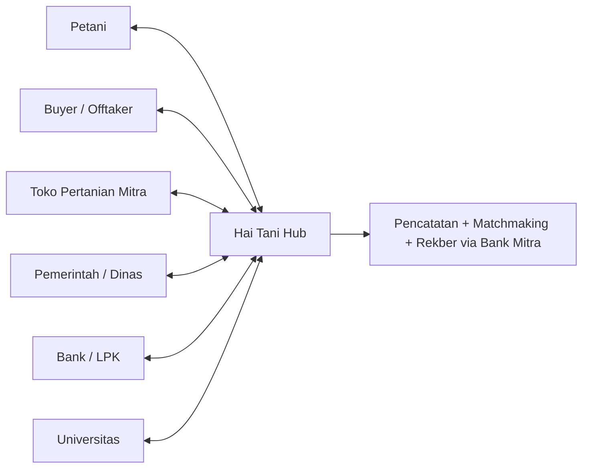

# Hai Tani Business Flow: Farm Ecosystem

Hai Tani is the connector in the middle: farmers record, buyers source, shops supply, banks lend, government monitors, universities research. Money for deals parks in a licensed partner escrow - never in Hai Tani's own pocket.

## Roles

- Petani (farmers): log land, stock, harvest, and input needs by WhatsApp chat or voice note; receive price signals; negotiate with buyers; build a verifiable track record.
- Buyer / Offtaker: post demand with specs (size, cut, packaging); get matched with ready-to-harvest farmers; pay into escrow; confirm delivery to release funds.
- Toko Pertanian Mitra (agri shops): listed with location and hours; receive farmer demand signals; fulfill fertilizer/medicine/seed needs linked from the Kemitraan tab.
- Pemerintah / Dinas / PPL: monitor prices and anomalies (complementing SP2KP), run census and subsidy programs, extend officer reach via chatbot; farmer groups feed Permentan 18/2026 carbon schemes.
- Perbankan / LPK (banks): use Hai Tani records as alternative credit data for KUR/micro-lending; act as the licensed escrow holder for deals.
- Universitas: anonymized datasets for agronomy and economics research; student extension programs (KKN) plugged into real farmer data; independent validation of recommendations.

## Money Flow (honest design)

Buyer → licensed partner escrow → released to farmer on delivery confirmation. Hai Tani orchestrates and records every step but never holds deal funds itself, because independent escrow requires a license: OJK Regulation 20/POJK.04/2021 requires licensed institutions as escrow agents, fund transfers fall under Act 3/2011, and informal rekber has no clear legal basis (UM Sorong journal, May 2025 — https://ejournal.um-sorong.ac.id/index.php/js/article/download/4213/2202/19988).

## Fintech Caution (learned, not repeated)

Hai Tani does NOT run P2P lending. TaniFund hit a 63.93% 90-day default rate and a prosecutor corruption/money-laundering probe; iGrow ended in legal dispute (OJK/Bareskrim escalation) — https://legal.isha.or.id/index.php/legal/article/download/1376/856 , https://indonesiabusinesspost.com/4919/financial-crimes/ojk-cracks-down-on-rising-fraud-cases-in-fintech-lending-sector. Lending stays with licensed banks; Hai Tani supplies the data pipeline and collection context only.

## Farmer Record Loop

Chat log → structured data (land, stock, price, deal) → dashboard + QR identity → credit/carbon eligibility → better prices and access → more logging. Each loop makes the next loan, deal, or carbon claim cheaper to verify.

## Revenue Sketch

Live: negotiation spread to kas, affiliate shop margin. Future: analytics SaaS for buyers/government, MRV pipeline share (see [carbon-roadmap.md](carbon-roadmap.md)), escrow-orchestration fee via the licensed partner.

## Status

Vision + partial MVP: recording, matchmaking, and shop-linking are live; bank escrow partnership, university data-sharing, and government program rails are next goals.
