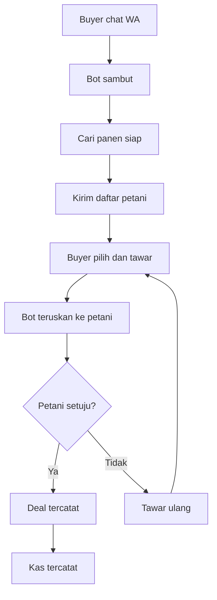

# Alur Negosiasi Buyer-Petani via WhatsApp

Fitur unggulan Hai Tani: mempertemukan buyer yang cari barang dengan petani siap panen (atau akan panen) lewat negosiasi chat yang terdokumentasi.

Penjelasan tiap langkah:

1. Buyer membuka chat WhatsApp Kang Tani dan menyampaikan kebutuhan (komoditas, volume).
2. Bot menyambut dan mencocokkan dengan data petani siap panen / akan panen.
3. Bot mengirim daftar petani (komoditas, estimasi tonase, lokasi).
4. Buyer memilih petani dan mengajukan penawaran harga.
5. Bot meneruskan penawaran ke petani.
6. Petani setuju (deal tercatat + kas tercatat) atau menolak (tawar ulang).
