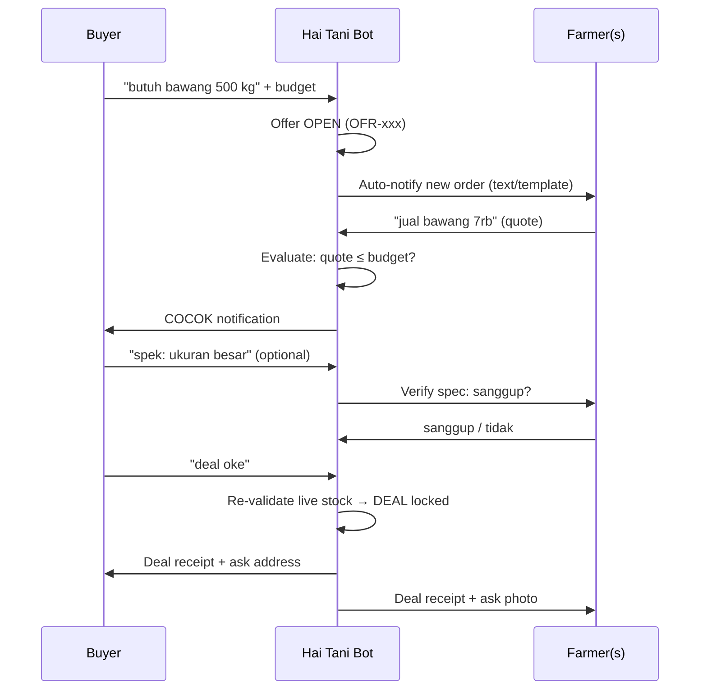
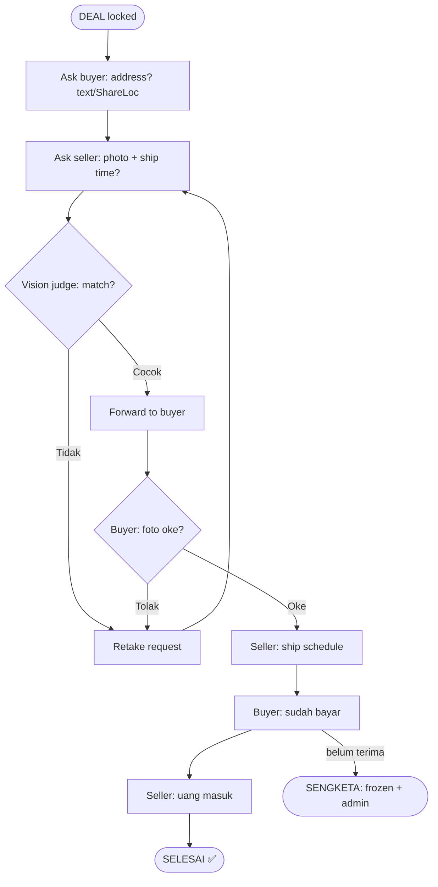

# Buyer-Farmer Negotiation Flow via WhatsApp

Hai Tani's flagship: a stateful bot matches buyers looking for harvest with ready-to-harvest farmers, then drives the deal to completion — no app install, just chat.

States: `OPEN → SEBAGIAN → COCOK → DEAL (terminal)`. Cheapest-first allocation can never oversell; the negotiated spread above the tier cap (5/2/0%) returns to the farmer via price top-up, the rest to kas.

## Post-Deal Fulfilment (automatic)

Commands: `minta foto [OFR-x]`, `teruskan/kirim/forward lokasi OFR-x`. Chat-cancel of a DEAL is refused — contact admin.
