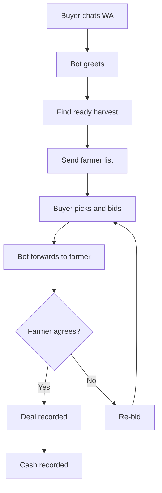

# Buyer-Farmer Negotiation Flow via WhatsApp

Hai Tani's flagship feature: matching buyers looking for goods with ready-to-harvest (or soon-to-harvest) farmers through documented chat negotiation.

Step by step:

1. The buyer opens the Kang Tani WhatsApp chat and states the need (commodity, volume).
2. The bot greets and matches with ready-to-harvest / soon-to-harvest farmer data.
3. The bot sends the farmer list (commodity, estimated tonnage, location).
4. The buyer picks a farmer and places a price bid.
5. The bot forwards the bid to the farmer.
6. The farmer agrees (deal recorded + cash recorded) or declines (re-bid).
