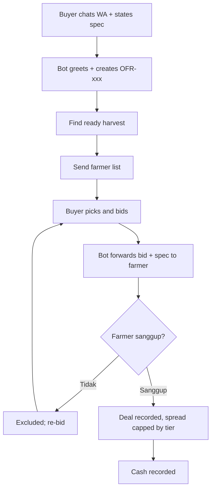

# Buyer-Farmer Negotiation Flow via WhatsApp

Hai Tani's flagship feature: matching buyers looking for goods with ready-to-harvest (or soon-to-harvest) farmers through documented chat negotiation.

Step by step:

1. The buyer opens the Kang Tani WhatsApp chat and states the need (commodity, volume, spec: size, cut, packaging, budget).
2. The bot greets, records the demand as OFR-xxx with the spec attached, and matches ready-to-harvest / soon-to-harvest farmers.
3. The bot sends the farmer list (commodity, estimated tonnage, location).
4. The buyer picks a farmer and places a price bid.
5. The bot forwards the bid plus the buyer spec to the farmer and asks for spec verification.
6. The farmer answers `sanggup` (can supply to spec → stays in allocation) or `tidak` (excluded from this offer).
7. When buyer budget meets a verified farmer ask, both sides confirm and the deal is recorded; Hai Tani takes at most the tier cap (5/2/0%) of the negotiated spread and returns the remainder to the farmer via price top-up.
8. Cash entry recorded; either side can re-bid if the budget does not meet.
